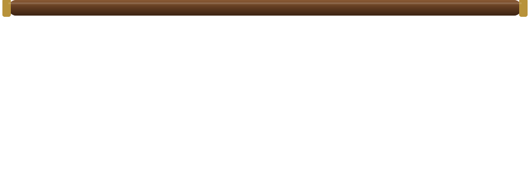
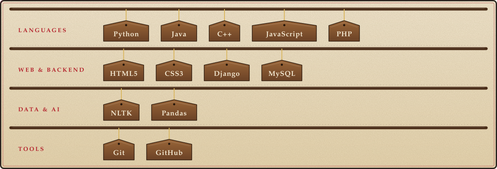
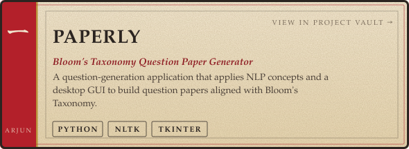
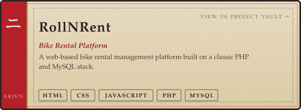
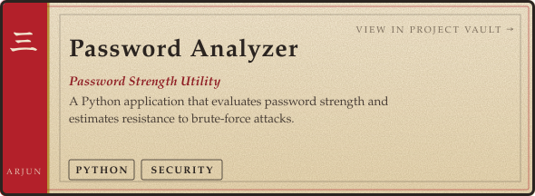
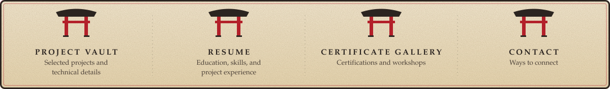

 

**Building practical software. Exploring intelligent systems. Designing modern web experiences.**

 

 

 

 

I'm a Computer Engineering student interested in software development, web technologies, automation, and AI-assisted applications. I enjoy turning ideas into useful projects and learning by building.

> **Portfolio →** [arjun-t-v.github.io/Arjun-portfolio](https://arjun-t-v.github.io/Arjun-portfolio/)

 

 

 

 

 

 

 

 

 

 

 

 

 

 

