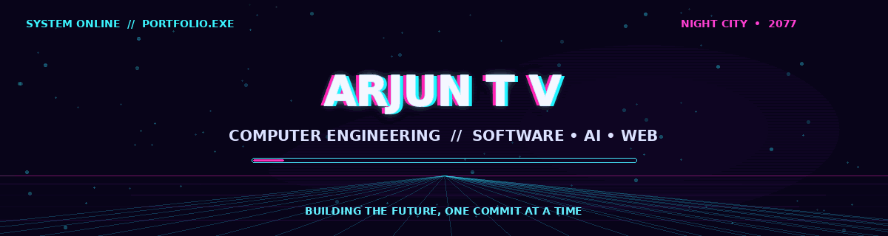

### `COMPUTER ENGINEERING STUDENT` · `SOFTWARE DEVELOPER` · `AI ENTHUSIAST`

**Building practical software. Exploring intelligent systems. Designing modern web experiences.**

---

## `01 // ABOUT ME`

I'm a Computer Engineering student interested in software development, web technologies, automation, and AI-assisted applications. I enjoy turning ideas into useful projects and learning by building.

- **Focus:** Software Engineering · Web Development · AI · NLP
- **Currently exploring:** Better application design, automation, and practical ML integrations
- **Portfolio:** [arjun-t-v.github.io/Arjun-portfolio](https://arjun-t-v.github.io/Arjun-portfolio/)

## `02 // TECH STACK`

## `03 // FEATURED PROJECTS`

<table>
<tr>
<td width="50%">

### ◈ PAPERLY
**Bloom's Taxonomy Question Paper Generator**

A question-generation application using NLP concepts and a desktop GUI.

`PYTHON` `NLTK` `TKINTER`

</td>
<td width="50%">

### ◈ RollNRent
**Bike Rental Platform**

A web-based bike rental management platform.

`HTML` `CSS` `JAVASCRIPT` `PHP` `MYSQL`

</td>
</tr>
<tr>
<td width="50%">

### ◈ Password Analyzer
**Password Strength Utility**

A Python application for evaluating password strength and estimating resistance to brute-force attacks.

`PYTHON` `SECURITY`

</td>
<td width="50%">

### ◈ PARKEASE
**Smart Parking Platform**

A parking-slot management project exploring IoT sensor integration and ML-based duration prediction.

`DJANGO` `PYTHON` `IOT` `ML`

</td>
</tr>
</table>

## `04 // PORTFOLIO MODULES`

- **PROJECT VAULT** — selected projects and technical details
- **RESUME** — education, skills, and project experience
- **CERTIFICATE GALLERY** — certifications and workshops
- **CONTACT** — ways to connect

## `05 // CONNECT`

*`ALWAYS LEARNING. ALWAYS BUILDING.`*

